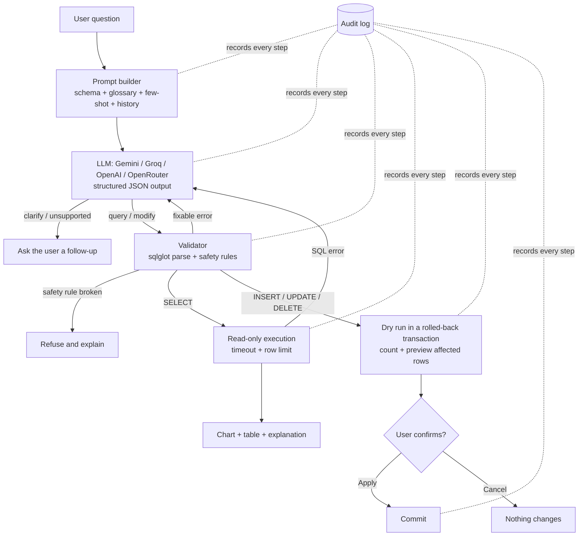

# AskData: a natural-language SQL agent

AskData lets people who don't know SQL ask questions about a database or an uploaded spreadsheet in plain English. It ships with a sample online store, and works with data from any field:

> "Which products had the highest return rate last month?"

The agent sends the question to an LLM (Google Gemini, Groq, OpenAI or OpenRouter, whichever you have a key for), which plans a query and returns structured JSON. AskData then checks that SQL against safety rules, runs it on the database, and shows the answer as a chart, a table and a short explanation. If the user asks to change data ("cancel order 2999"), the change is dry-run and previewed, and nothing is written until the user confirms.

**Live app:** https://ask-data-dashboard.streamlit.app/?u=CZSaOiYHYYQE-9LYOqVfgv2HoQsWE3cQc29KQDZpcD8 ·
**Demo video:** https://youtu.be/QXp6vzd67gA

---

## The problem

Business data lives in databases, but most people who need answers from it (store managers, support leads, marketers) can't write SQL. They wait on an analyst for simple questions or work from stale spreadsheet exports. LLMs can write SQL, but connecting an LLM straight to a database is risky:

- It can invent tables or columns.
- It can write queries that run forever.
- It can be talked into `DROP TABLE`.

AskData puts a validation and confirmation layer between the model and the data. The model proposes; the agent checks, runs, and asks the user before any change.

## How it works



### Assignment requirements → where they are

| Requirement | Implementation |
|---|---|
| **LLM integration**: connect to an API, send and receive | `agent/llm.py` supports Google Gemini (`google-genai` SDK, schema-enforced JSON) and any OpenAI-compatible API: Groq, OpenAI, OpenRouter (`openai` SDK, JSON mode) |
| Handle API errors and rate limiting | Client-side sliding-window limiter. On 429/5xx/timeouts the client switches to another model, then backs off exponentially (honouring the server's retry delay) inside a 45-second budget. Retired models are skipped and the provider is asked which models the key can use. If one provider stays overloaded, a second configured provider takes over. Bad keys get a clear message |
| **Action interpreter**: parse LLM output | `parse_agent_json` checks the JSON, intent and required fields; the chart spec is checked against the real result columns (`agent/charts.py`) |
| Convert to executable operations, in several domains | Database reads (SELECT), database writes (INSERT/UPDATE/DELETE), chart rendering (Plotly), file export (CSV download), file import (CSV upload becomes a new table) |
| **User interface** | Streamlit web app: chat-style questions, step trail per answer, charts, SQL viewer, follow-up suggestions, data browser, activity log |
| **Validate LLM output before executing** | `agent/validator.py`: parse with sqlglot, single statement, table allow-list, blocked statement types and functions, `LIMIT` enforced |
| Handle errors gracefully | Fixable errors go back to the model for self-correction (up to 2 retries); otherwise a plain-language message is shown |
| Confirmation for destructive operations | Writes are off by default. When enabled, every change is dry-run first, and the user sees the row count and the affected rows before choosing Apply or Cancel |
| Log all actions | `agent/audit.py` writes one JSONL line per step (question, LLM response, validation, execution, dry run, commit/cancel), viewable and downloadable in the Activity log tab |

## Prompt engineering techniques

All prompts are in [`agent/prompts.py`](agent/prompts.py).

1. **Role and task framing.** The system instruction casts the model as a careful analyst whose output is parsed by a program, so precision beats creativity.
2. **Schema grounding.** The real `CREATE TABLE` structure, row counts, sample rows, and the distinct values of categorical columns (e.g. `status: 'Cancelled', 'Delivered', ...`) are read live from the data source (`agent/schema.py`). This prevents invented columns and misspelled filter values, and works for any dataset. Values of columns marked sensitive are replaced with `<hidden>` before the prompt is built.
3. **Business context per data source.** Each data source carries its own semantic configuration (`data/metadata.py`): glossary, metric definitions, table and column descriptions, synonyms, date fields, join relationships, default filters and preferred charts. Nothing about any industry is written into the global prompt; the sample store's definitions live in `data/sample_store.py`.
4. **Dialect rules and today's date.** The prompt gives the exact date functions for the data source's SQL dialect (SQLite, PostgreSQL or MySQL notes) and the current date for relative time ranges.
5. **Structured output.** With Gemini, a JSON response schema is enforced by the API (`response_schema`). With Groq, OpenAI and OpenRouter, JSON mode is on and the same format is spelled out in the prompt (`JSON_FORMAT_INSTRUCTIONS`). Either way the reply is checked by `parse_agent_json`, including the `intent` enum: `query | modify | clarify | unsupported`.
6. **Plan before SQL.** A `reasoning` field comes first in the schema, so the model states its tables, joins and filters before writing the query.
7. **Few-shot examples.** Worked examples for each behaviour: a number, a comparison, a clarifying question, a safe modification, and an out-of-scope request. The sample store has hand-written ones; for any other dataset they are generated from its schema, and tests check that every generated example passes the validator and runs.
8. **Conversation memory.** The last 3 turns are included, so follow-ups like "now break that down by month" work.
9. **Self-correction loop.** If the SQL fails validation or SQLite returns an error, the error goes back to the model in a repair prompt for another attempt. The UI shows "Self-corrected 1×" and the failed attempt.
10. **Low temperature (0.1)** for consistent SQL.
11. **Injection resistance.** The prompt states that schema text, sample rows and earlier results are data, never instructions. Long or multi-line cell values are clipped to one short comment line, and free text is never listed as a category value. The validator still blocks unsafe SQL if a model is fooled anyway.

## Working with your own data

AskData is not tied to the sample store. Upload a CSV and it becomes a table in a separate data source called **Uploaded files**, with its own conversation, starter questions and business context. Several files uploaded in one session join the same source, so they can be queried together. Dates written in spreadsheet styles (`03/15/2026`, `Jan 5, 2026`) are rewritten as `YYYY-MM-DD` on import so time questions work.

For each data source, the **Data** tab shows what the AI sees and lets you edit its **business context**:

| Setting | Example |
|---|---|
| Glossary | "Active customer" = a customer with at least one non-cancelled order |
| Metrics | Revenue = `SUM(order_items.quantity * order_items.unit_price)` |
| Table and column descriptions | `order_items.unit_price`: price actually paid per unit |
| Words users say | "clients" means customers |
| Sensitive columns | `customers.email` (values are never sent to the AI) |
| Date fields, join relationships | `orders.order_date`; `orders.customer_id = customers.customer_id` |
| Default filters, ownership rules | `status != 'Cancelled'`; only `region = 'West'` |
| Preferred charts, starter questions | "revenue over time": line |

A starting configuration is suggested automatically from the schema: date fields, joins from foreign keys, columns that look like personal data, and starter questions. You can download a configuration as JSON and load it again later.

Two limits to know about. Default filters and ownership rules guide the AI's queries; they are not access controls, and the database does not enforce them. Sensitive columns are hidden from the AI and results that read them are not saved, but masking them on screen is not built yet.

### Adding another kind of database

1. Write a class that implements `DataSourceAdapter` (`data/adapters.py`): `schema()`, `preview()`, `run_read()`, and optionally `dry_run_write()` and `commit_write()`. Reads must run on a connection that cannot write, and the adapter must enforce its own `limits` (query timeout and row cap).
2. Set `info.dialect` to the sqlglot dialect name (`"postgres"`, `"mysql"`). The validator parses and rewrites SQL in that dialect, and the prompt switches to that dialect's notes.
3. Register it: `register_adapter_type("postgres", PostgresAdapter)` in `data/registry.py`.

The validator already blocks system catalogs, file and sleep functions, `COPY`, `SELECT ... INTO` and similar statements for PostgreSQL and MySQL. Only SQLite has a working adapter today; no PostgreSQL or MySQL adapter is included.

## Saved conversations, workspaces and identity

Conversations are saved as you go and are still there after a reload or restart. The sidebar has **New conversation** and a **Recent** list; clicking a recent conversation reopens it with its charts.

**Where things are kept.** Everything lives in one data folder (`var/` by default, or `ASKDATA_DATA_DIR`):

```
var/
  askdata_meta.db              metadata: workspaces, conversations, messages, query runs, business context
  workspaces/<workspace id>/   that workspace's own data files (its copy of the sample, its uploads)
```

The metadata database is separate from any data being analysed, and is never shown to the model.

**What is saved for each answer.** The question, the explanation, the SQL, the chart choice, timings and the outcome, plus a preview of the result (up to 200 rows) so charts reappear. Results are **not** saved when the query reads a column marked sensitive; those answers show a **Run again** button instead. Set `ASKDATA_STORE_RESULTS = "off"` to never save result rows. Anything shaped like a password or API key is masked before it is stored.

**Nothing loaded from storage is trusted to run.** Saved SQL is validated from scratch before a re-run, and only read-only queries can be re-run. A data change that was waiting for confirmation when you left is put through a fresh dry run when you come back; if it no longer passes, it is cancelled.

**Workspaces.** A workspace has its own data, business context and conversations, and nothing is shared between workspaces. Create and switch them in the **Settings** tab. Every database query for conversations and messages includes the workspace, so one workspace cannot read, change or delete another's records even with a correct id.

**Who owns a workspace** is set by `ASKDATA_AUTH`:

| Mode | Behaviour | Use it for |
|---|---|---|
| `local` | Everyone using the app is one owner | The app on your own computer |
| `link` | Each browser gets a private address (`?u=...`). Bookmark it to return. Anyone with the address can read those conversations | A public demo without sign-in |
| `login` | Streamlit's built-in sign-in; the owner is the account | A real multi-user deployment |

If `ASKDATA_AUTH` is not set, the app uses `local` on `localhost` and `link` everywhere else, so a public deployment never puts all visitors in one shared workspace. Only a hash of the link token or account id is stored. The `login` mode needs an identity provider configured in Streamlit's `[auth]` secrets and has not been tested against a live provider.

**The sample store is rebuilt each day** so its dates stay current. Edits you make to the sample data last until the next day; uploaded files are kept until you remove them.

### Working with conversations

| You want to | Where |
|---|---|
| Start fresh, or go back to an earlier conversation | **New conversation** and the list in the sidebar |
| Find a conversation | The search box searches titles, questions, answers and SQL. **Filters** narrows by category, data source, tag, last activity (in your own time zone), or shows archived ones |
| Rename, set a category or tags, pin, duplicate, archive, delete | **Manage**, next to the conversation's title |
| Get a different answer, or retry after a failure | **Regenerate** (or **Try again**) under the latest answer |
| Change an earlier question | **Edit question** under that turn. It replaces the question and removes the turns after it |
| Keep a result, or bookmark a chart or query | **Save** under an answer; find them in the **Saved** tab, preview them there, or use **Open conversation** to jump back to where they came from |
| Take a conversation elsewhere | **Manage → Export** as JSON, Markdown or printable HTML (open it and print to PDF) |
| See how an answer was produced | **How I got this** under each answer: SQL, reasoning, outcome, intent, where it was answered from, data source and tables, any remembered context with its source, rows, timings, model, and the safety checks that applied |
| Stop a request that is taking too long | Streamlit's **Stop** control at the top right. A turn is only saved when it finishes, so nothing half-done is kept |

Rules that protect the record:

- Regenerating or editing **hides** the earlier version; it is kept in the database, not deleted, and is left out of search and exports.
- A data change that was **applied** can't be regenerated, and questions at or before it can't be edited, so the record of a change is never hidden.
- Regenerating, editing or opening another conversation **cancels** a change that was still waiting for confirmation. A duplicated conversation never carries a pending change.
- **Archive** hides a conversation but keeps it. **Delete** removes it permanently, with its answers and anything saved from it, after a confirmation.
- Exports are built from what is stored, so result rows that weren't allowed to be saved (sensitive columns) are absent from every format. HTML exports contain no scripts and escape all content.

**How conversations are categorized.** A new conversation gets a category from its first question using keyword rules in `agent/conversation.py` (`CATEGORY_RULES`): Trends over time, Rankings, Breakdowns, Totals and counts, Lookups, Data changes, or General. The first matching rule wins. There is no model call, so it is instant and predictable. You can change the category, or type a new one, under **Manage**.

**How search works.** Migration 2 adds an SQLite FTS5 full-text index over questions, answers and SQL, kept up to date by database triggers. Search words are quoted before they reach the index, so punctuation in a search can't act as search syntax. On an SQLite build without FTS5 the index is skipped and search falls back to plain matching. Every search is limited to the current workspace.

## Memory

AskData carries context forward in three layers.

| Layer | What it holds | How long it lasts |
|---|---|---|
| Recent turns | The last 3 successful turns of the open conversation, word for word | The conversation |
| Conversation summary | Older turns condensed to one line each: the question, the gist of the answer, and the measures, groupings and filters its query used; applied data changes and open questions are called out | The conversation |
| Long-term memory | Preferences, default filters, preferred date ranges and charts, business definitions, saved analyses, notes | The workspace, across conversations |

**Where long-term memories come from.** Only from your own words:

- Say **"remember that ..."** in a conversation. It is stored immediately and no model call is made.
- Add one in the **Memory** tab.
- **Approve a suggestion.** When a question contains a standing instruction ("from now on ...", "always ...", "by default ..."), a definition ("when I say X I mean Y"), a chart preference, or you ask for the same time range three times, AskData offers to remember it. A suggestion is not used until you approve it. A rejected one is kept, marked rejected, so it is not offered again.
- **Saving a result** remembers its name and question, so you can refer back to it.

Query results are never turned into memory. Text containing an email address, a long number or something shaped like a key is never suggested, and saved analyses are not remembered when their query read a sensitive column.

**Controls** (Memory tab): turn long-term memory off for the workspace, view what is remembered and where each item came from, edit, pin, change which data it applies to, delete, approve or reject suggestions, forget one conversation's memory, forget everything, and download all conversations. Every delete asks for confirmation first.

No part of memory calls the model: summaries and suggestions use rules, so they are free, immediate, repeatable and work offline.

### How the prompt context is assembled

`agent/context.py` builds every prompt, in this order:

1. Role, today's date, and the active data source's name.
2. The schema of that data source, with sensitive values hidden.
3. Its business context (glossary, metrics, joins, default filters).
4. **What the user asked to be remembered:** the long-term memories chosen for this question.
5. **Earlier in this conversation:** the summary, when the conversation is longer than the recent-turn window.
6. Dialect notes and the rules.
7. Worked examples, then the recent turns in full, then the new question.

Items 1 to 3 and 6 are always sent whole. Items 4, 5 and the recent turns share a token budget (`ASKDATA_CONTEXT_TOKENS`, default 2,000, estimated at four characters per token): long-term memory may use up to 30% of it and the summary up to 25%; recent turns get what is left, newest first, and the latest turn is always kept. The activity log records how many tokens each part used and which memory ids were included, but not the memory text.

### How memories are retrieved

For each question, `MemoryService.retrieve` in `agent/memory.py`:

1. **Takes candidates** from the current workspace only: active memories that apply to the active data source, meaning those tied to it plus workspace-wide ones. A memory tied to another data source is never considered.
2. **Keeps** a candidate if it is pinned, is a standing instruction (preference, default filter, date range, chart), or shares meaningful words with the question. Word matching uses both exact keywords (stop words removed, light stemming) and the SQLite FTS5 index when it exists.
3. **Scores** what is left: word overlap, rank in the full-text index, +1 if it came from the open conversation, up to +1 for recency (fading over 90 days), its importance, +1.5 for a standing instruction and +5 if pinned.
4. **Cuts to the budget**, best first, skipping any that would not fit.

Each memory that goes into a prompt is saved with the answer together with a citation, which the answer's details show as, for example, "Based on a previous conversation from November 8". Dates are shown in the reader's own time zone.

### API keys on a public deployment

There are two ways the app can get a key, and you can use either or both:

| Option | How | Who pays for usage | Good for |
|---|---|---|---|
| **The app's own key** | You put `GROQ_API_KEY` (or another provider's key) in the app's Secrets on Streamlit Cloud | You | A class demo or portfolio link: graders and visitors just use it |
| **Visitors' own keys** | A visitor pastes a key in the form on the Ask tab, or in **Settings → AI model** | The visitor | A public app you don't want to pay for |

If the app has no key of its own, a visitor sees "Add an API key to start asking questions" with the form, instead of an error. If it has one, they can still switch to their own key in Settings and back.

Visitors choose from Groq, Gemini, OpenRouter and OpenAI, or **Enter your own** for any provider with an OpenAI-compatible API (Together, Mistral, DeepSeek, a company gateway): its https address, model name and key. That address must resolve to the public internet, so it can't be used to reach the server itself or its private network (localhost, 10.x, 192.168.x, cloud metadata addresses), and redirects are not followed. The check happens when the key is entered; a host that later changes what it resolves to isn't re-checked. Set `ASKDATA_ALLOW_CUSTOM_PROVIDERS = "off"` to offer only the listed providers.

A visitor's key is held only in that browser session's memory. It is never written to the metadata database, the activity log, exports or the page; the form clears itself after submitting; and it is gone when the page is closed. It is sent to the provider the visitor chose, which needs it to answer. Anyone running the server could in principle read process memory, so visitors should use a key they can revoke, and only on deployments they trust. Set `ASKDATA_ALLOW_USER_KEYS = "off"` to hide the form and use only the app's key.

If you publish with your own key, the per-session limit (`REQUESTS_PER_MINUTE`) slows a single visitor down but doesn't cap total use, and opening new tabs starts new sessions. Use a free-tier key, or set a spending limit in your provider's console.

### Metadata database and migrations

The database is created on first run. Its structure is only ever changed by a numbered migration in `storage/migrations.py`:

1. Append `Migration(<next number>, "<what it does>", (<SQL statements>,))` to `MIGRATIONS`. Never edit one that has shipped.
2. Start the app. Pending migrations run in order, each inside a transaction, and are recorded in the `schema_migrations` table.

Before upgrading a database that already holds data, a backup copy is written beside it (`askdata_meta.db.v<N>.<time>.bak`). If a migration fails it is rolled back and the database stays at its previous version.

If the database cannot be opened or upgraded (a corrupt file, a file from a newer release, a folder that cannot be written), the app does not stop and does not modify the file. It runs with a temporary in-memory store and shows **"Conversations aren't being saved"** with the reason.

To move to PostgreSQL later: ids are text, timestamps are ISO text, all SQL is in `storage/repositories.py` with parameters, and the rest of the app only uses the repository methods.

### Settings

Set these in `.streamlit/secrets.toml`, Streamlit Cloud Secrets, or as environment variables.

| Setting | Default | Meaning |
|---|---|---|
| `GEMINI_API_KEY`, `GROQ_API_KEY`, `OPENAI_API_KEY`, `OPENROUTER_API_KEY` | none | At least one is required |
| `LLM_PROVIDER` | every provider with a key | Order of providers, e.g. `groq,gemini` |
| `<PROVIDER>_MODEL` | chosen automatically | Pin a model, e.g. `GROQ_MODEL` |
| `REQUESTS_PER_MINUTE` | `8` | LLM calls per session per minute |
| `ASKDATA_DATA_DIR` | `var/` | Folder for the metadata database and workspace data |
| `ASKDATA_AUTH` | `local` on localhost, else `link` | Who owns a workspace (see above) |
| `ASKDATA_STORE_RESULTS` | `on` | `off` stops result previews being saved |
| `ASKDATA_ALLOW_USER_KEYS` | `on` | `off` hides the form where visitors can enter their own API key |
| `ASKDATA_ALLOW_CUSTOM_PROVIDERS` | `on` | `off` removes the "Enter your own" provider option |
| `ASKDATA_CONTEXT_TOKENS` | `2000` | Token budget shared by long-term memory, the conversation summary and recent turns in each prompt |
| `ASKDATA_LOG_PATH` | `logs/audit.jsonl` | Activity log file |
| `ASKDATA_MAX_ROWS` | `1000` | Most rows one answer may return (10 to 10,000) |
| `ASKDATA_QUERY_TIMEOUT_S` | `8` | Seconds before a query is stopped (0.5 to 60) |
| `ASKDATA_RATE_PER_MINUTE` | `10` | Questions a minute per workspace (`0` turns the limit off) |
| `ASKDATA_RATE_PER_DAY` | `300` | Questions a day per workspace |
| `ASKDATA_RATE_PER_CLIENT_MINUTE` | `20` | Questions a minute from one network address, however many private links it opens |
| `ASKDATA_RATE_GLOBAL_PER_MINUTE` | `60` | Questions a minute across all visitors answered with the app's own key (visitors' own keys don't count) |

## The interface

* **Left sidebar:** new conversation (Alt+N), search, filters, pinned and recent conversations, the workspace and data source, and the switches for data changes and the context panel.
* **Middle:** the conversation. Each answer is a result card: a one-sentence summary, the source, time, row count and query time, then the result as a number, table or chart. Switch between Number, Table, Bar, Line, Area, Pie, Scatter or No chart; only views that fit the result are offered, and the choice is saved with the answer. Under it: Download CSV, Save, Ask a follow-up, Explain this result (what the query did, in plain English), and Change filters. **How I got this** shows the SQL, the reasoning and every safety check.
* **Right context panel:** the data source and when its structure was read, whether changes are allowed, the latest query's tables and filters, the business rules and metrics the AI was given, anything remembered that this answer used, and related conversations. It moves below the chat on narrower screens and can be hidden.
* **Question box:** type a question, or attach a CSV to it; the file becomes a table and the question is asked about it.
* **Light and dark:** AskData follows your system setting; change it from ⋮ › Settings. Charts switch colours with it.

Design tokens, components, the Figma import and how to add a chart type are in [docs/design-system.md](docs/design-system.md).

## Safety design

The model is treated as untrusted: code, not another model, decides what runs. The full model, with the test that covers each safeguard and the known limits, is in [docs/security.md](docs/security.md).

- **Every statement is validated** before it reaches a database: first answers, self-corrections, re-runs of saved queries, and confirmed changes, which are checked again just before they're applied.
- **Blocked always:** `DROP`, `ALTER`, `CREATE`, `PRAGMA`, `ATTACH`, `VACUUM`, `SELECT INTO`, multiple statements, system tables (`sqlite_*`, `pragma_*`, `information_schema`, ...), and file, extension, sleep and memory-exhausting functions.
- **Defence in depth.** Reads run on a SQLite connection opened in `mode=ro`, so they physically can't write, and no value a query builds may exceed 10 MB.
- **Changes** need the toggle on, a `WHERE` clause that mentions a column (no `WHERE 1 = 1`), a dry run, a preview and explicit confirmation. At commit the row count is checked again; if the data changed since the preview, nothing is applied.
- **Sensitive columns** (set per data source in the Data tab): their values are never sent to the model, answers that read them aren't saved, and their values are **masked in results**: partly (`m•••@example.com`), fully, or not at all, as the owner chooses. Masking follows the SQL, so `UPPER(email) AS contact` is masked and `products.name` isn't confused with `customers.name`. It applies to tables, charts, CSV downloads, change previews and the data preview.
- **Limits:** query time and result rows per query (settings above), questions a minute and a day per workspace and per network address, and an app-wide cap on questions answered with the app's own key. Limits are shared by every session, so a new tab or private link doesn't reset them. A refused question never reaches the model.
- **Isolation:** every workspace has its own data files, conversations, saved items and memories, and every storage query is scoped to a workspace that belongs to its owner, so a guessed id returns nothing.
- **Secrets:** API keys live in Streamlit secrets or, for visitors, only in their session's memory. Connection details, stored text and the activity log are scrubbed of anything shaped like a password, token or key.
- **Untrusted data:** data values in the prompt are short, single-line and declared to be data, not instructions; uploaded names are rebuilt from a strict character set. Whatever the model is persuaded to write still has to pass the validator.
- **Labelling and audit:** answers and exports say they're generated by an AI model, and every question, model response, validation, block, masking, rate limit and change is in the activity log. Result rows never are.

## Run it locally

```bash
git clone <your-repo-url> askdata && cd askdata
python -m venv .venv && source .venv/bin/activate      # Windows: .venv\Scripts\activate
pip install -r requirements.txt
cp .streamlit/secrets.toml.example .streamlit/secrets.toml
# edit .streamlit/secrets.toml: remove the # in front of one provider's line and paste your key
# (free keys: console.groq.com/keys or aistudio.google.com/apikey)
streamlit run app.py
```

The sample database is generated automatically on first run. Its dates are relative to today, so "last month" always has data.

Run the tests (no API key needed; scripted fake LLMs stand in for the real providers):

```bash
python -m pytest -q
```

## Deploy (Streamlit Community Cloud, free)

1. Push this folder to a **public** GitHub repo. The `.gitignore` already excludes `secrets.toml`.
2. Go to [share.streamlit.io](https://share.streamlit.io), sign in with GitHub, and click **Create app**. Pick the repo, branch `main` and main file `app.py`.
3. Open **Advanced settings → Secrets** and paste:
   ```toml
   GROQ_API_KEY = "your-key"       # or GEMINI_API_KEY, OPENAI_API_KEY, OPENROUTER_API_KEY
   ```
4. Click **Deploy**. Your public URL looks like `https://<name>.streamlit.app`.

**Saved conversations on Streamlit Community Cloud last only until the app restarts.** Its disk is wiped on each restart or redeploy, which removes the data folder. For lasting storage, run the app on a host with a persistent disk and point `ASKDATA_DATA_DIR` at it. On a public address the app uses private links by default (`ASKDATA_AUTH = "link"`), so each visitor gets their own workspace.

Adding keys for two providers (for example Groq and Gemini) makes the demo more reliable: if one is overloaded, the app switches to the other. To pin a model, set `GROQ_MODEL`, `GEMINI_MODEL`, etc. in secrets; otherwise the app picks one and falls back automatically.

## Project structure

The code is layered. Each layer only calls the one below it, and nothing below `ui/` imports Streamlit.

```
app.py                 Thin shell: builds the services once per session and hands them to the views
services.py            Composition root: wires the LLM, data sources, audit log and conversation service
ui/                    Streamlit views (no business logic)
  theme.py             Design tokens (light and dark); generates config.toml and docs/design-tokens.json
  components.py        Reusable pieces: notices, step trail, metric, tables, charts (all text is escaped)
  chat_view.py         Chat turns, result cards (views and actions), details, confirmation panel, question box
  context_view.py      The context panel: data source, safety, latest query, business rules, memory used
  conversation_view.py Sidebar (new conversation, search, filters, list) and the Saved tab
  data_view.py         CSV upload, data browser and business-context editor
  memory_view.py       The Memory tab: view, add, edit, approve, delete and clear memories
  settings_view.py     Activity log and settings (saving, identity, workspaces)
agent/                 The agent itself
  conversation.py      Conversation service: ask, confirm, cancel, regenerate, edit, save and reload; categories
  export.py            Conversation export as JSON, Markdown and printable HTML
  context.py           Assembles the prompt within a token budget: schema, memory, summary, recent turns
  citations.py         Where an answer came from: the query, and any memory used
  memory.py            Recent turns, the rolling summary, and long-term memory (suggest, approve, retrieve)
  pipeline.py          The loop: LLM -> validate -> execute or dry-run -> chart
  llm.py               LLM clients (Gemini + OpenAI-compatible): structured output, rate limiting, retries, fallback
  prompts.py           Generic system prompt, dialect notes, generated examples, repair prompt, JSON schema
  schema.py            Reads a database's structure for the prompt
  validator.py         SQL safety and correctness checks (sqlglot)
  executor.py          Read-only execution, dry runs, confirmed commits
  charts.py            Chart specs, view switching (with a table fallback) and Plotly figures
  masking.py           Hides sensitive values in results, traced through the SQL
  ratelimit.py         Question limits shared by every session
  explain.py           Plain-English description of what a query did, for "Explain this result"
  audit.py             JSONL audit log
data/                  Data sources
  adapters.py          The data-source interface every database type implements
  sqlite_adapter.py    SQLite implementation
  csv_adapter.py       CSV upload -> table, with strict name cleaning and date standardisation
  registry.py          Each session's private data sources, and the list of adapter types
  metadata.py          Semantic configuration per data source, and suggestions built from a schema
  sample_store.py      Everything specific to the sample dataset, including its semantic configuration
  seed.py              Generates the sample e-commerce database
storage/               Saved conversations (never analytical data)
  database.py          Opens the metadata database; falls back to memory if it can't
  migrations.py        Numbered, transactional structure changes with backup
  models.py            Records: workspace, data source, conversation, message, query run, tag, saved item, memory item
  repositories.py      All SQL for those records, scoped to a workspace, including search and filters
  identity.py          Who owns a workspace: local, private link or sign-in
tests/                 410 offline tests: pipeline, LLM errors, services, data sources, storage, chat operations,
                       memory, charts, design tokens and contrast, security, interface
docs/
  developer-guide.md   How a question flows, prompt assembly, memory retrieval, categories, adding an adapter
  security.md          Every safeguard, the test that covers it, and the known limits
  design-system.md     Tokens, components, themes, layout, Figma import, adding a chart type
  design-tokens.json   Generated tokens for Figma (Tokens Studio)
```

To add another kind of database, implement `DataSourceAdapter` in a new file under `data/` and register it; the agent and the interface don't change. [docs/developer-guide.md](docs/developer-guide.md) walks through it.

## Demo video script (about 2 minutes)

| Time | Show |
|---|---|
| 0:00–0:15 | The problem: "Managers can't write SQL. AskData lets them ask in English, safely." |
| 0:15–0:45 | Ask *"Which products had the highest return rate last month?"* Point out the step trail, the chart, then open **How I got this** to show the SQL and reasoning. |
| 0:45–1:00 | Switch the chart to Pie, open **Explain this result**, then ask *"Show monthly revenue for the last 12 months"* (line chart). |
| 1:00–1:10 | Ask *"Who are our best customers?"* The agent asks a clarifying question instead of guessing. |
| 1:10–1:35 | Turn on **Allow data changes** and ask *"Cancel order 2999"*. Show the dry-run preview, click **Apply change**. Then ask *"Drop the orders table"* and show it is blocked. |
| 1:35–1:50 | Open the **Activity log** tab to show every step recorded. |
| 1:50–2:00 | Close by summarizing the agent loop and safety checks. |
